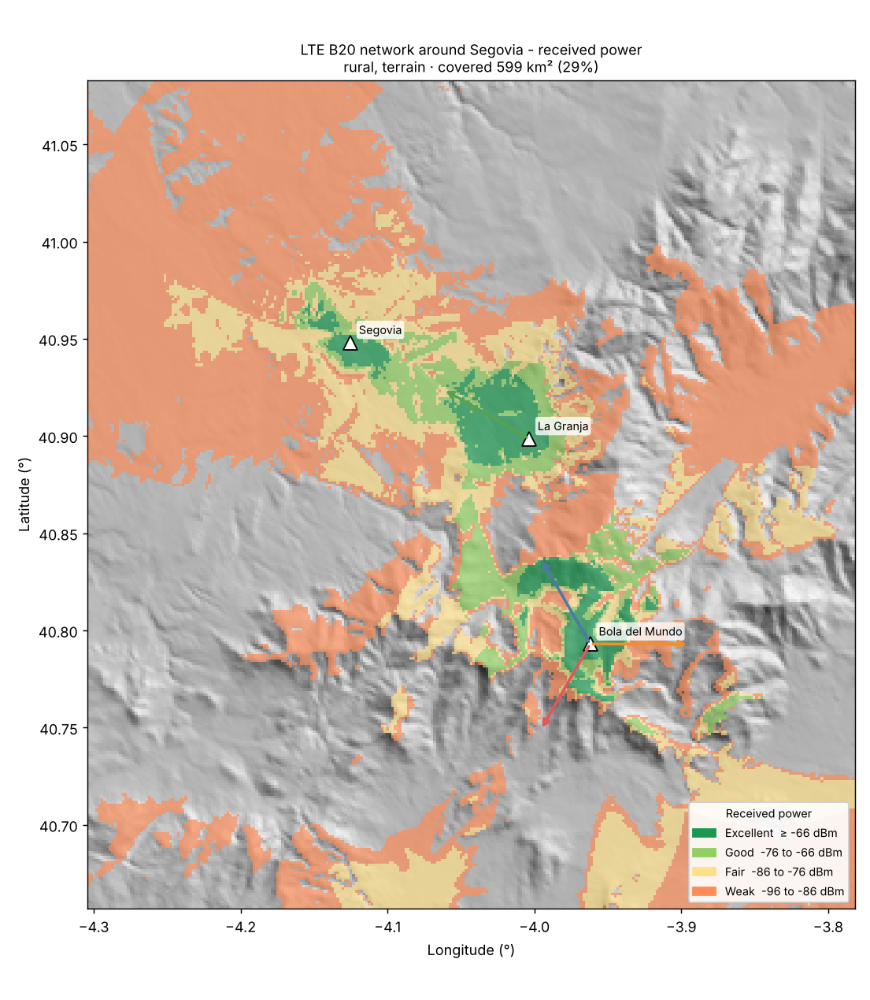
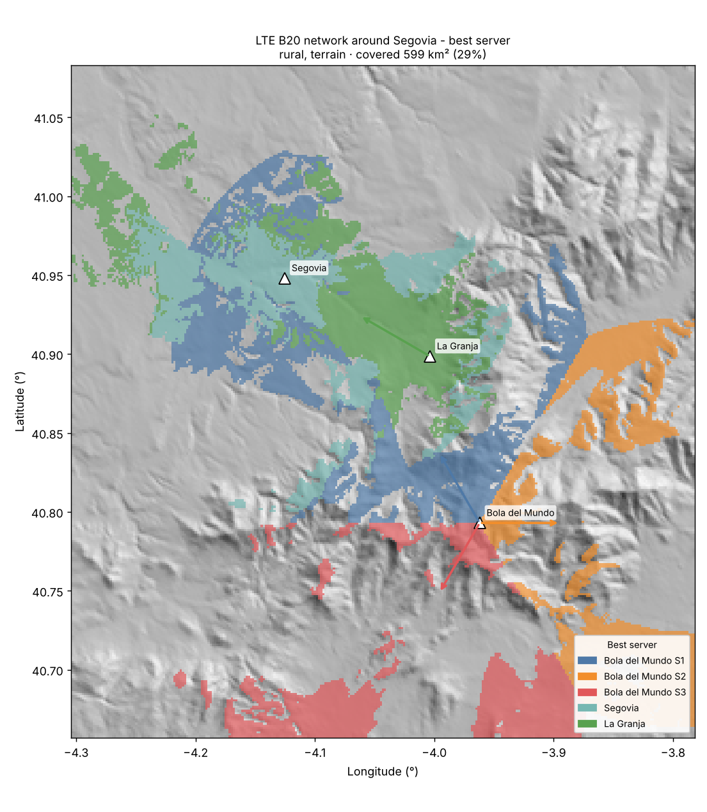
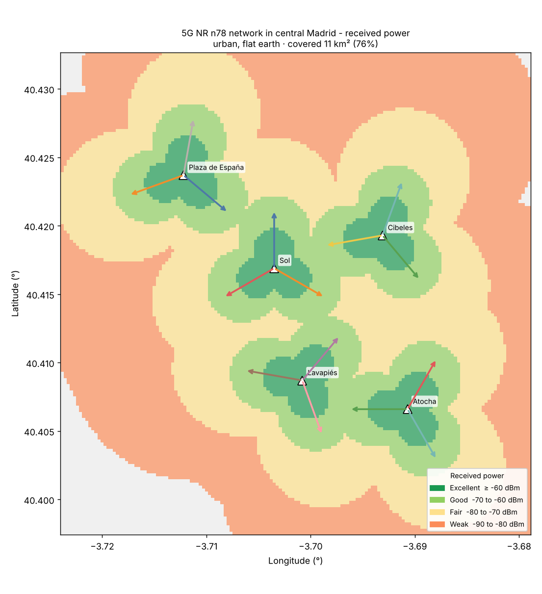
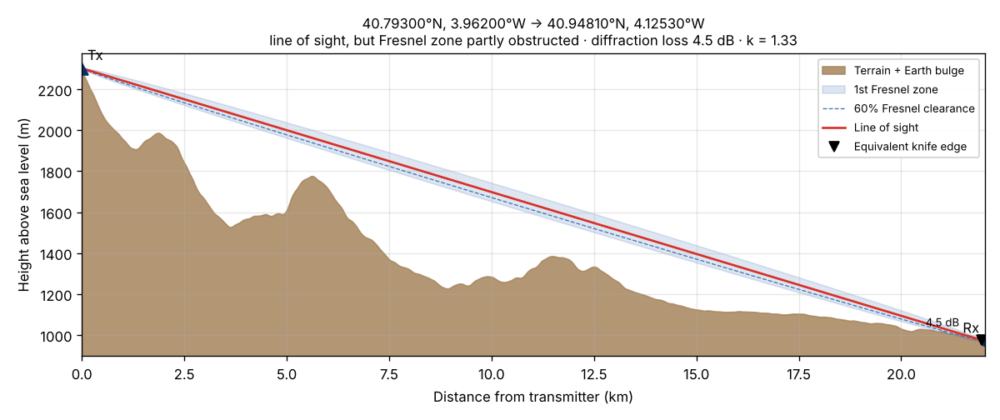

# Radio Coverage Visualizer — LTE/5G in Spain


A radio network planning tool written in Python that predicts the coverage of
**LTE and 5G NR** base stations anywhere in **Spain**. It goes from a classic
link budget to coverage maps over **real terrain**, using the propagation models
of the ITU-R, COST-231 and 3GPP.

> **Resumen (ES):** herramienta de planificación radio en Python que predice la
> cobertura de estaciones base LTE y 5G en España: presupuesto de enlace, modelos de
> propagación (Okumura-Hata, COST-231, 3GPP TR 38.901), relieve real con difracción
> (ITU-R P.526), mapas de cobertura y de mejor servidor, exportación a Google Earth y
> una aplicación web. Guía en español: [docs/GUIA_ES.md](docs/GUIA_ES.md).

| Coverage of an LTE 800 MHz network over real terrain | Best server of each point |
|---|---|
|  |  |
| **5G NR n78 network in central Madrid (3GPP urban model)** | **Terrain profile of a 22 km link** |
|  |  |

## Features

- **Link budget**: EIRP, path loss, received power, receiver sensitivity from thermal
  noise (kTB + NF + SNR), fade margin and maximum range.
- **Spanish LTE/5G bands** built in: n28 (700 MHz), B20 (800), B8 (900), B3 (1800),
  B1 (2100), B7 (2600) and n78 (3.5 GHz).
- **Propagation models**: free space (Friis), Okumura-Hata, COST-231 Hata and
  3GPP TR 38.901 Urban/Rural Macro, with an automatic choice by frequency and warnings
  when a link is outside a model's validity range.
- **Real terrain** for all of Spain (mainland, Balearic and Canary Islands, Ceuta and
  Melilla): elevation profile, line of sight, first Fresnel zone clearance, Earth bulge
  (k = 4/3) and **Bullington knife-edge diffraction** (ITU-R P.526).
- **Coverage maps** over a grid with **sector antenna patterns** (3GPP TR 36.814),
  several sites, **best-server** analysis and covered-area statistics.
- **Outputs**: interactive HTML maps (OpenStreetMap and IGN base maps / aerial imagery),
  **KMZ for Google Earth**, PNG images over shaded relief and terrain profile charts.
- **Web app** (Streamlit) and **command line** interface with TOML configuration files.
- **220+ automated tests** run on every push with GitHub Actions (Python 3.11–3.13).

## Quick start

Requires Python 3.11 or newer.

```bash
git clone https://github.com/DanielJusto1/visualizador-coberura.git
cd visualizador-coberura
python -m venv .venv
source .venv/bin/activate        # Windows: .venv\Scripts\activate
pip install -e ".[dev,web]"
```

### Web app

```bash
streamlit run app/streamlit_app.py
```

Pick a site on the map of Spain, a band and the antenna parameters, and get the coverage
map, the link budget and the terrain profile in the browser.

### Command line

```bash
# Coverage of a 5-site 5G n78 network in central Madrid
radiocoverage coverage --config examples/coverage_5g_n78_madrid.toml --map madrid.html

# LTE 800 MHz rural network over real terrain, exported to Google Earth
radiocoverage coverage --config examples/coverage_lte_b20_segovia.toml \
    --map segovia.html --kmz segovia.kmz --image segovia.png

# Point-to-point link over real terrain with its profile chart
radiocoverage link --config examples/lte_b20_navacerrada_segovia.toml \
    --map link.html --profile profile.png

# A single sector, everything given as options
radiocoverage coverage --band B3 --tx-lat 37.3891 --tx-lon -5.9845 --azimuth 120 \
    --tx-power 46 --tx-gain 17 --sensitivity -100 --radius 5 --terrain --map sevilla.html

# Reference information
radiocoverage bands
radiocoverage models
```

Run `radiocoverage link --help` or `radiocoverage coverage --help` for every option.
Elevation data are downloaded the first time an area is used and cached in
`~/.cache/radiocoverage`.

Example of a link budget report (free space vs. real model and terrain on the same path):

```
Link budget - LTE B20 (806 MHz)
==================================================
Path
  Distance                         22.04 km
  Propagation model         Okumura-Hata
  Environment               rural
  Path loss                 -     144.43 dB
  Terrain                   line of sight, but Fresnel zone partly obstructed
  Min. Fresnel clearance           12.82 %
  Diffraction loss          -       4.49 dB
Receiver
  Received power            =     -90.92 dBm
  Sensitivity                     -95.98 dBm
    (from kTB: 10 MHz, NF 9 dB, SNR -1 dB)
  Margin                            5.06 dB
  Required margin                  10.00 dB
--------------------------------------------------
Result: LINK FAILS (margin 5.06 dB, required 10.00 dB)
```

With free space the same link would show a 36.5 dB margin: choosing a realistic
model and including the terrain changes the engineering decision.

## How it works

| Step | Formula / method |
|---|---|
| EIRP | `EIRP = P_tx + G_tx − L_tx` |
| Received power | `P_rx = EIRP − A(θ) − L_path − L_diffraction − L_other + G_rx − L_rx` |
| Sector antenna | `A(θ) = min(12·(θ/θ_3dB)², A_m)` (3GPP TR 36.814) |
| Free space | `FSPL = 20·log10(d_km) + 20·log10(f_MHz) + 32.45` |
| Okumura-Hata | 150–1500 MHz, urban / suburban / open corrections |
| COST-231 Hata | 1500–2000 MHz, +3 dB in dense urban areas |
| 3GPP TR 38.901 | UMa NLOS (urban) and RMa NLOS (rural), 0.5–7 GHz |
| Thermal noise | `N = −174 dBm/Hz + 10·log10(B)` |
| Sensitivity | `S = N + NF + SNR_min` |
| Fresnel zone | `r₁ = √(λ·d₁·d₂ / (d₁ + d₂))`, clear if ≥ 60 % free |
| Earth bulge | `h = d₁·d₂ / (2·k·R)`, k = 4/3 |
| Diffraction | Bullington equivalent knife edge, `J(ν)` from ITU-R P.526 |
| Distances | Haversine great-circle formula |

All power quantities are handled in decibels, so gains and losses simply add up.
Empirical models are never allowed to predict less loss than free space. The `auto`
model uses Okumura-Hata below 1500 MHz, COST-231 Hata up to 2000 MHz and 3GPP TR 38.901
above.

## Project structure

```
src/radiocoverage/
    units.py          dB/dBm/W conversions, wavelength
    bands.py          LTE/5G bands used in Spain
    receiver.py       thermal noise and sensitivity
    propagation.py    path loss models and model registry
    antenna.py        sector antenna pattern
    link_budget.py    point-to-point link budget
    geo.py            coordinates, distances, azimuths, Spanish territory check
    fresnel.py        Fresnel zones and Earth bulge
    path.py           geometry of a Tx-Rx path
    terrain.py        elevation tiles with cache and interpolation
    profile.py        terrain profile, clearance and Bullington diffraction
    coverage.py       coverage grid, sites, receivers and best server
    rendering.py      colour classes and image helpers
    link_map.py       interactive link map
    coverage_map.py   interactive coverage map
    coverage_plot.py  static coverage image over shaded relief
    kmz.py            Google Earth export
    cli.py            command line interface
app/streamlit_app.py  web interface
examples/             ready-to-run configurations with real Spanish locations
tests/                automated tests (pytest)
docs/                 Spanish guide and images
```

## Running the tests

```bash
pytest
ruff check . && ruff format --check .
```

Tests never touch the network: terrain is replaced by synthetic elevation models.

## Publishing the web app

The app can be deployed for free on [Streamlit Community Cloud](https://streamlit.io/cloud):
sign in with GitHub, choose this repository, branch `main` and the file
`app/streamlit_app.py`. Dependencies are read from `requirements.txt`.

## Limitations

- Empirical models predict the *median* path loss; real signals vary several dB around
  it (shadow fading). The fade margin accounts for that variation.
- The elevation model (~30 m) has no buildings or vegetation. Inside cities the 3GPP
  urban model is more meaningful than the terrain profile.
- Received power is the total power over the channel, not RSRP; interference and
  capacity are out of scope.

## Data sources

- Elevation: [Terrarium terrain tiles](https://registry.opendata.aws/terrain-tiles/)
  (Tilezen / AWS Open Data, built from SRTM and other public elevation models).
- Base maps © [OpenStreetMap](https://www.openstreetmap.org/copyright) contributors and
  © [Instituto Geográfico Nacional de España](https://www.ign.es) (IGN base map and PNOA
  aerial imagery, CC BY 4.0).

## References

- M. Hata, "Empirical formula for propagation loss in land mobile radio services",
  IEEE Trans. Veh. Technol., 1980.
- COST Action 231, *Digital mobile radio towards future generation systems*, final report, 1999.
- 3GPP TR 38.901, *Study on channel model for frequencies from 0.5 to 100 GHz*.
- 3GPP TR 36.814, *Further advancements for E-UTRA physical layer aspects*.
- ITU-R P.525 (free space) and ITU-R P.526 (propagation by diffraction).

## License

MIT — see [LICENSE](LICENSE).
